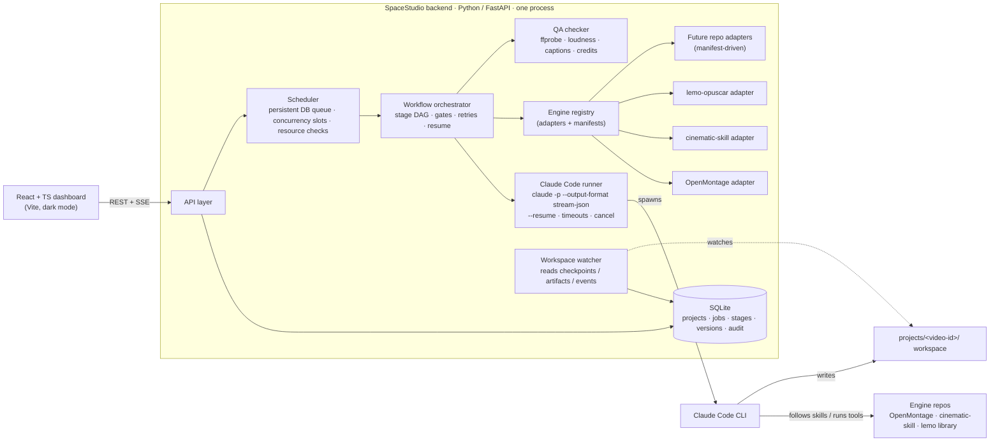
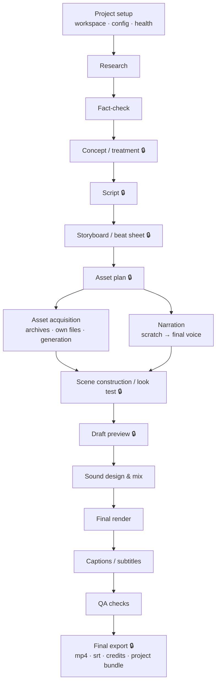

# SpaceStudio — Phase 1: Repository Audit & Integration Plan

Status: **awaiting approval**. No application code has been written yet.

Audited on 2026-11-26 from fresh shallow clones of each repository's default branch:

| Repository | Version inspected | Files |
|---|---|---|
| OpenMontageInc/OpenMontage | `main` HEAD | ~2,285 |
| Moh4696/cinematic-skill | v1.0.1 (CHANGELOG 2026-11-09) | 50 |
| lemomo-ai/lemo-opuscar | v2.0.0 (`package.json`) | ~3,950 |

Claude Code CLI inspected: **2.1.332** (`claude --help`).

---

## 1. What each repository actually is

All three are **agent-driven workflows, not libraries with a callable API**. Each one is a set of instructions (Markdown skills/guides) that a coding agent like Claude Code follows, plus helper scripts the agent runs. None of them exposes an HTTP API or a single "make video" command. So the realistic integration is: **SpaceStudio drives Claude Code, and Claude Code drives the repo.**

### 1.1 OpenMontage — a multi-pipeline video production platform (agent-first)

- **What it is:** about 180 Python tools (`tools/`, all built on `BaseTool`) plus 13 YAML pipeline manifests (`pipeline_defs/`), stage "director" skills (`skills/pipelines/<pipeline>/<stage>-director.md`) and meta skills (reviewer, checkpoint protocol). `PROJECT_CONTEXT.md` says it plainly: *"No Python orchestrator… The agent drives the pipeline."*
- **How it's invoked:** open the repo in Claude Code (its `CLAUDE.md` says to read `AGENT_GUIDE.md`) and ask for a video. Rule Zero: every request goes through a pipeline, with a mandatory preflight (`registry.provider_menu_summary()`).
- **Pipelines (verified stage lists):**
  - `animated-explainer`, `animation`, `cinematic`: research → proposal → sample → script → scene_plan → assets → edit → compose → publish
  - `character-animation`: adds character_design and rig_plan
  - `documentary-montage`: idea → scene_plan → assets → edit → compose (cut from real footage)
  - `talking-head`, `hybrid`, `avatar-spokesperson`, `clip-factory`, `podcast-repurpose`, `localization-dub`: idea → script → scene_plan → assets → edit → compose → publish
  - `screen-demo`: adds real_capture and synthetic_terminal
  - `framework-smoke`: test harness
- **Machine-readable state (useful to us):**
  - `projects/<id>/project.json`
  - `checkpoint_<stage>.json` with `status` (`in_progress`, `awaiting_human`, `completed`, …), `human_approval_required`/`human_approved`, `cost_snapshot`, `error`
  - `history/` with superseded checkpoints, so versions are kept
  - `artifacts/*.json`, validated against `schemas/artifacts/`
  - `events.jsonl`, real tool start/finish/error events written by `BaseTool`
  - `lib/checkpoint.py` enforces approval gates: writing a gated stage as `completed` without `human_approved=True` raises `GATE VIOLATION`.
- **`OPENMONTAGE_PROJECTS_DIR`** (in `lib/paths.py`) moves the projects root, so each SpaceStudio video can keep its OpenMontage workspace inside its own directory.
- **Backlot** (`python -m backlot open <id>`): a read-only local board at 127.0.0.1 that reads those same files.
- **Budget:** `config.yaml` has `budget.mode: warn`, `total_usd: 10.00`, `single_action_approval_usd: 0.50` and `require_approval_for_new_paid_tool: true`. `tools/cost_tracker.py` estimates, reserves and reconciles spend.
- **Rendering:** FFmpeg, Remotion (`remotion-composer/`, Node `^22.23.4 || ^24.22.1 || ^26.12.1`) and HyperFrames (pulled with `npx`).
- **Licence:** **AGPL-3.0.**

### 1.2 cinematic-skill — one Claude Code skill: `cinematic-film`

- **What it is:** a single skill (`skills/cinematic-film/SKILL.md`) and 16 Python scripts. Films are drawn entirely in code with Skia: one continuous camera over a board of photos, documents, cards, maps and counters, with every visual hit timed to the narration. No video generation is involved.
- **How it's installed:**
  - Claude plugin: `.claude-plugin/marketplace.json`
  - `npx skills add`
  - `install.sh --claude` (symlinks into `~/.claude/skills`; `--copy` for Windows)
- **Every script takes `--project <folder>`** (verified with argparse). In workflow order:
  - `check_setup.py`, `get_fonts.py`, `new_project.py`
  - `make_beats.py`: writes `beats.md`, lints chronology
  - `tts_say.py`: macOS `say`, espeak-ng, or any TTS through `--cmd '… {txt} {out}'`
  - `split_takes.py`, `build_narration.py`: produce `audio/narration.m4a` and `audio/timing.json`
  - `fetch_commons.py`: `search`, `category`, `get`, `credits`. Uses the Wikimedia Commons API, records licences and **refuses non-free files**.
  - `make_map.py`, `prep_assets.py`
  - `render.py`: `--probe`, `--strip`, `--cues`, full render with `--workers`
  - `build_sfx.py`: synthesised sound effects
  - `mix_soundtrack.py`: ducking, LUFS normalisation
  - `burn_captions.py`: 4 caption styles plus SRT
- **Built-in gates (4):** approve `beats.md` (including facts), approve the look stills, watch a 30 s draft, then finish.
- **Looks:** wall, slate, studio, charcoal, blueprint, paper, night.
- **Licence:** **MIT.**

### 1.3 lemo-opuscar — a library of 99 film styles with a shared toolkit

- **What it is:**
  - 99 styles (`styles/<slug>/STYLE.md` + `style.json`) in 15 categories
  - guides: `AGENTS.md`, `DIRECTOR.md`, `TECHNIQUE.md`, `MY-STYLES.md`
  - shared tools in `core/`
  - The agent writes an HTML/canvas/WebGL page with `window.render(t)`, which is rendered frame by frame in headless Chromium (Playwright). Score, SFX and narration are generated in code too.
- **How it's invoked:**
  - Claude plugin: `claude plugin marketplace add lemomo-ai/lemo-opuscar`, then `claude plugin install lemo-opuscar@lemolab`
  - or run `claude` inside a clone
  - The skill runs `setup.sh`, which makes a sparse clone into `~/lemo-opuscar` and prints `LIB=<path>`. Then it follows `AGENTS.md`.
- **Workflow:**
  1. Brief: **one** round of questions
  2. `TREATMENT.md`
  3. Look frames
  4. Storyboard, **only if asked** (the one optional gate)
  5. Produce: voice → ASR check → score → animation → mix → render
  6. Self-check
  7. Deliver: `<name>.mp4`, `poster.jpg`, `.srt`, `TREATMENT.md`, `CREDITS`, `build.sh`
- **Tools (verified in `core/README.md`):**
  - `still.mjs`, `video.mjs`, `events.mjs`, `readcheck.mjs`, `mux.sh` (−14 LUFS)
  - `tts.py` (Kokoro, offline), `tts_zh.py` (edge-tts, online), `asr_check.py` (faster-whisper)
  - `sfx.py`, `sampler.py`, `srt.py`
  - `gen_image.py` (Codex CLI, only for ✦ styles)
  - Exit codes are documented.
- **Concurrency hooks that already exist:**
  - `RENDER_SLOTS` caps concurrent full renders across processes
  - `setup.sh deps` takes a lock folder
  - each film lives in its own folder
- **Licence:** code is **MIT**. Docs and style prompts are **CC BY-NC 4.0**, with an extra grant that lets you and your collaborators use them to make your own films, commercial ones included. **Putting the docs into a commercial product or service needs a commercial licence.** Films you make are yours and need no credit. The Clawd character and third-party marks are excluded.

---

## 2. Capability matrix

| | **OpenMontage** | **cinematic-skill** | **lemo-opuscar** |
|---|---|---|---|
| **Verified capabilities** | Research with web search, proposal with cost estimate, script, scene plan, asset generation (image/video/TTS/music through ~180 tools), stock and archive retrieval, edit, compose (Remotion/HyperFrames/FFmpeg), subtitles, review, publish. Reference-video analysis. 13 pipelines. | Research and fact notes, script, beat table with lint, scratch and final voice with line splitting, Wikimedia images with licences, maps, Skia-drawn film, synthesised SFX, mix, 4 caption styles plus SRT, credits.md | 99 code-drawn styles (painting, whiteboard, newsreel, satellite, blueprint, pixel, 3D…), treatment, look frames, optional storyboard, Kokoro/edge-tts voice with ASR check, sampled or synthesised score, SFX, mix at −14 LUFS, SRT, CREDITS, reproducible `build.sh`. Custom "my styles". |
| **Inputs** | Prompt, optional reference video URL/file, source footage, `music_library/` | Prompt, optional own photos (`assets/photos/`), optional own voice recording, optional score | Prompt plus style name, optional own voice, music, photos, logos, data |
| **Outputs** | `projects/<id>/renders/final.mp4`, `artifacts/*.json`, `assets/**`, `subtitles.srt`, checkpoints, `events.jsonl` | `<project>/out/*.mp4`, `script.json`, `beats.md`, `photos.json`, `audio/narration.m4a`, `audio/timing.json`, `credits.md`, SRT, stills | `<project>/<name>.mp4`, `poster.jpg`, `.srt`, `TREATMENT.md`, `CREDITS`, `build.sh`, stills |
| **Invocation** | Claude Code with cwd = repo (CLAUDE.md, then AGENT_GUIDE.md) | Claude Code skill `cinematic-film` (plugin or `~/.claude/skills`); scripts with `--project` | Claude Code plugin skill `lemo-opuscar:lemo-opuscar`; tools run from `$LIB` |
| **System deps** | Python 3.10+ (pinned 3.11), Node 22.23+/24/26, npm, FFmpeg, optional Piper, optional GPU | Python 3.9+, skia-python, numpy, pillow, (scipy), FFmpeg with libx264, loudnorm and sidechaincompress, espeak-ng or `say` | Node 20+, **FFmpeg 7+** (6.x is rejected), Python 3.11+ or uv, Playwright headless Chromium. GPU for 3D/WebGL styles (`LEMO_ANGLE=swiftshader` otherwise, slow). About 350 MB core, +0.55 GB voice. |
| **Credentials** | None required. 50 optional keys in `.env.example` (FAL, ElevenLabs, OpenAI, Google, Runway, Kling, HeyGen, Suno, Pexels, Pixabay, Unsplash…) | None | None (✦ styles need a signed-in Codex CLI) |
| **Cost** | Free path exists. Paid providers cost money (README examples: $0.15–$3 per video). **`.env` is loaded automatically at import** (`base_tool._load_dotenv`), so any key there is live. | Free | Free, except the 3 ✦ styles (image generator) and edge-tts (free online Microsoft service, external terms) |
| **Concurrency limits** | Isolated per `projects/<id>`. Shared repo `.env`, `config.yaml` and npx/Remotion caches. Backlot uses one port. Remotion renders are CPU/RAM heavy. | Isolated per `--project`. `render.py --workers 0` means "as many as fit in memory", so **two concurrent renders will each assume all of RAM**. We must cap `--workers`. | Isolated per film folder. Shared `$LIB` (deps lock exists). `RENDER_SLOTS` caps renders. `video.mjs` uses up to 6 workers. |
| **Integration approach** | Claude Code session with cwd = OpenMontage clone and `OPENMONTAGE_PROJECTS_DIR` = this video's dir. Stage state comes from reading checkpoint and event JSON (no imports, which keeps AGPL code at arm's length). | Claude Code session with the skill loaded (`--plugin-dir` or installed skill) and project folder = this video's dir. Stage state is derived from the files it produces. | Claude Code session with `--plugin-dir <clone>/plugin` and `LEMO_OPUSCAR_HOME` = shared library, cwd = this video's dir. Stage state is derived from the files it produces. |

### What overlaps and what is unique

- **Overlap:**
  - All three do script → narration → visuals → mix → captions → render, end to end.
  - TTS exists in all three: Piper (OpenMontage), espeak/any command (cinematic), Kokoro (lemo).
  - Wikimedia sourcing exists in OpenMontage and cinematic.
- **Unique:**
  - **OpenMontage:** real-footage montage, AI image/video generation providers, reference-video analysis, footage editing (talking head, podcast, clip factory, localisation/dub), formal checkpoint and budget system.
  - **cinematic-skill:** the evidence-board documentary grammar with word-synced hits, and a strict free-licence image fetcher.
  - **lemo-opuscar:** breadth of visual styles (99), with original scores built from free sample libraries.

---

## 3. Can all three be used together?

**Yes in one application. Only partly within a single video.**

- **Within one application: yes.** All three run under Claude Code, keep each video in its own folder, need no paid keys for their core path, and run on Linux (and on Windows with caveats, see §7). SpaceStudio can offer all three as **engines** and pick one per video.
- **Within one video: only through verified hand-offs, not by merging pipelines.** Each repo owns its whole timeline and renderer (Remotion/HyperFrames vs Skia vs headless-Chromium pages). They share no file format, so you can't feed OpenMontage's `edit_decisions` into cinematic's `scene.py`. What *is* feasible and safe:
  1. **Shared pre-production.** SpaceStudio's own research, fact-check and script stages (run by Claude) produce a neutral `brief.json` and `script.json`. Each engine adapter asks Claude to translate them into the engine's native form: `script.json` for cinematic, `TREATMENT.md` for lemo, the `research_brief`/`script` artifacts for OpenMontage. Translation, not a shared format.
  2. **Asset hand-offs.** cinematic's `fetch_commons.py` (licence-checked) can supply images to any engine, and the user's own voice recording or music can go to any engine.
  3. **Segment assembly** (later milestone, optional): render, say, an intro in a lemo style and a body in OpenMontage, then join them with FFmpeg after normalising resolution, fps and loudness. It works technically but looks inconsistent. I'd offer it as an advanced option, not a default.
- **Not feasible:** running two engines' stages interleaved on one timeline, or using a repo "feature" that isn't one of its documented tools.

---

## 4. Zero-cost feasibility

| Engine | Zero-cost? | What you get | Caveats |
|---|---|---|---|
| cinematic-skill | **Fully** | Whole pipeline: espeak-ng or Piper voice (through `--cmd`), Wikimedia public-domain/CC images, synthesised SFX, Skia render | espeak-ng sounds robotic; Piper is better and also free. No music unless you supply it. |
| lemo-opuscar | **96 of 99 styles** | Kokoro offline English voice, Whisper check, procedural or sampled score (free libraries, CC/CC0, credited), SFX | ✦ styles (Manga Panels, Text Flash Cuts, Comic History Cartoon) are disabled. Chinese narration uses edge-tts (online, free, Microsoft terms). WebGL styles are slow without a GPU. |
| OpenMontage | **Partial, by pipeline** | Piper TTS, Remotion/HyperFrames/FFmpeg, Archive.org/NASA/Wikimedia footage (`documentary-montage`), data-driven and motion-graphics explainers, local character animation | No AI image/video generation. Pexels/Pixabay/Unsplash need *free* developer keys. **Risk:** paid keys in OpenMontage's `.env` are auto-loaded, so zero-cost mode must make sure no paid key is visible (see below). |
| **Claude Code itself** | **Not free** | Orchestration | Every job uses Claude tokens from your plan or API key. lemo says a film takes 30–60 min "and a fair amount of tokens". SpaceStudio will show Claude cost from the stream-json `result` event where it's reported, and can pass `--max-budget-usd` per job. |

**How zero-cost mode will be enforced (several layers, because no single one is enough):**

1. SpaceStudio launches each Claude Code process with an **environment allow-list**. Paid-provider variables (every key in OpenMontage's `.env.example` except free-tier stock keys you explicitly allow) are removed from the child environment.
2. **Health check blocks zero-cost jobs** while OpenMontage's `.env` contains non-empty paid keys, because `base_tool._load_dotenv` would fill in any variable that is missing or empty. The fix offered: move the keys out, or point SpaceStudio at a separate keyless clone.
3. A prompt contract tells Claude: zero-cost is on, never select a tool whose runtime is `api`, report blocked capabilities instead of substituting.
4. After each stage, SpaceStudio reads OpenMontage's `cost_snapshot` and `events.jsonl`. Any non-zero provider cost **stops the job** and flags it.
5. lemo ✦ styles and OpenMontage paid-only pipelines are hidden in zero-cost mode.

A paid provider is never turned on without your explicit approval for that job.

---

## 5. Recommended integration architecture

**One local process, modular.** No microservices, no Redis or Celery.



### 5.1 How SpaceStudio drives Claude Code (verified CLI flags)

Each job is a Claude Code session, started headless:

```
claude -p "<stage prompt>" \
  --output-format stream-json --verbose \
  --permission-mode <mode> --allowedTools "<scoped list>" \
  --add-dir <engine repo> --plugin-dir <engine plugin, if any> \
  --append-system-prompt "<SpaceStudio stage protocol>" \
  [--model …] [--effort high] [--max-budget-usd …]
```

- **The stream** gives us the live activity log (tool calls, messages) and a final `result` event. We record the session ID, model and cost from it.
- **Gates use `--resume <session-id>`.** Claude ends its turn at a gate (all three repos already tell it to). SpaceStudio marks the stage *Waiting for approval*. When you approve or ask for changes, it resumes the *same* session with your decision and feedback, so context is kept.
- **Stage protocol (appended system prompt).** Claude must:
  - work only inside the video's workspace and the engine repo
  - append stage events to `.spacestudio/events.jsonl`
  - stop at every gate SpaceStudio configured
  - never ask questions mid-run. Questions go into a `needs_input` event, which the UI shows as **"Needs your input"**, not as running.
- **Truth comes from files, not from Claude's word.**
  - OpenMontage: stage status from `checkpoint_<stage>.json`
  - cinematic and lemo: status from the presence and validity of the artifacts each stage is documented to produce, e.g. `beats.md` → story done, `audio/timing.json` → voice done, `TREATMENT.md` → treatment done
  - **No fake progress.** A percentage appears only where a tool really reports one (e.g. frame counts in render logs). Otherwise a stage shows *Running* plus the latest real log line.
- **Permissions.** A scoped `--allowedTools` list: Read/Edit/Write, plus Bash for `python`, `node`, `ffmpeg`, `ffprobe`, `sh <engine scripts>`, `git` (for the lemo clone). Anything else Claude tries gets denied, and the denial is shown as **"Needs action"** in the UI. No `--dangerously-skip-permissions`.
- **Restarts.** Job state lives in SQLite. When the app starts, any job marked *running* whose process is gone becomes *interrupted*. Resuming goes back to the last completed stage taken from the files, and continues with `--resume` and an instruction to verify outputs before redoing work. That prevents duplicate execution.

> **To verify in the Phase 3 spike, not assumed:** how permission denials and Claude's own question attempts appear in the `-p` stream-json output, and whether `--plugin-dir` loads both plugin layouts cleanly (lemo's `plugin/` and cinematic's root `.claude-plugin`). Fallback for the second: link the skills with `install.sh` (cinematic) or the documented `claude plugin install`.

### 5.2 Engine adapter contract (this is also how future repos plug in)

Each engine is an `engines/<id>/engine.yaml` manifest plus a small Python adapter:

```yaml
id: cinematic-skill
repo: { url: https://github.com/Moh4696/cinematic-skill, path: ~/.spacestudio/engines/cinematic-skill, license: MIT }
invocation: { kind: claude-skill, plugin_dir: ".", skill: cinematic-film }
requires: { commands: [python3, ffmpeg, ffprobe], python: ">=3.9", pip: [skia-python, numpy, pillow] }
health_checks: ["python3 skills/cinematic-film/scripts/check_setup.py"]
cost: { zero_cost: true, paid_env: [] }
concurrency: { render_heavy_stages: [render, finish], workers_flag: "--workers" }
presets: [documentary, history, product-story, science, space]
stages:
  - { id: story,    gate: true,  produces: [script.json, beats.md] }
  - { id: images,   produces: [photos.json, credits.md] }
  - { id: voice,    produces: [audio/narration.m4a, audio/timing.json] }
  - { id: look,     gate: true,  produces: ["stills/*.png"] }
  - { id: draft,    gate: true,  produces: [out/draft.mp4] }
  - { id: sound,    produces: [audio/mix.m4a] }
  - { id: finish,   gate: true,  produces: ["out/*.mp4", "*.srt"] }
```

Adapter methods: `health()`, `capabilities(config)`, `plan(config) → stages`, `stage_prompt(stage, feedback)`, `detect(workspace) → stage states`, `outputs(workspace)`.

**Adding a future repository:** in *Settings → Engines → Add repository* you give a URL or local path. SpaceStudio runs an **"engine onboarding" Claude Code job** that reads the repo (README, licence, skills, scripts) and drafts an `engine.yaml`: capabilities, commands, stage map, health checks, costs. Nothing is enabled until you review and approve it. A generic manifest-driven adapter covers most agent-skill repos; a custom Python adapter is only needed for repos with an unusual state format.

### 5.3 Batch and concurrency

- A persistent queue in SQLite. Jobs survive restarts.
- **Global slots** (configurable):
  - `max_claude_sessions` (default 2)
  - `max_render_jobs` (default 1)
  - per-engine caps
- The scheduler checks free RAM and CPU before it admits a job.
- **Renders run inside Claude's Bash, so the render cap is enforced two ways:**
  1. Native limits we pass in: lemo `RENDER_SLOTS`, cinematic `--workers N`, OpenMontage render concurrency
  2. A `spacestudio-slot` wrapper (a file-lock semaphore) that the prompt contract tells Claude to wrap heavy commands in

  This enforcement is cooperative and I'll state that in the UI. A Claude Code `PreToolUse` hook that blocks unwrapped render commands can make it strict. I'll test that in Phase 6.
- **Isolation per video:**
  - `projects/<video-id>/` as cwd
  - its own `.spacestudio/` state and logs, temp dir (`TMPDIR`), and engine workspace (`OPENMONTAGE_PROJECTS_DIR` for OpenMontage)
  - its own Claude session

  Shared, read-only-by-convention resources (the engine clones, the lemo `$LIB`) are flagged in Repository Health if they're modified while jobs run.

### 5.4 Stack

| Layer | Choice | Why |
|---|---|---|
| Frontend | React + TypeScript + Vite, Tailwind, TanStack Query, SSE for live updates | Your stated preference. SSE is enough for one-way log/status streaming. |
| Backend | Python 3.11+, FastAPI, SQLModel/SQLAlchemy + Alembic | Matches the engines' Python. A clear path to PostgreSQL. |
| Queue | In-process asyncio scheduler over SQLite tables | No extra services for local use |
| Media | ffprobe/FFmpeg for QA, previews and thumbnails | Already required by all engines |

### 5.5 Licensing guardrails (built into the design)

- **OpenMontage (AGPL-3.0):** SpaceStudio won't import or copy its code. It runs OpenMontage as a separate program through Claude Code and reads its JSON output files. That keeps SpaceStudio's own licence independent.
- **lemo-opuscar docs (CC BY-NC 4.0):** SpaceStudio won't bundle or redistribute its Markdown. It uses your own install of the library. If you ever sell SpaceStudio as a product, the lemo docs need LemoLab's commercial licence. Films you make are yours.
- **Third-party assets:** every engine's `CREDITS`/`credits.md` is collected into the project's `credits/` folder and checked by QA.

---

## 6. Unified production workflow

SpaceStudio stages (left) map onto each engine's real stages (right). A stage appears only if the selected engine actually has it. Gates marked 🔒.



| SpaceStudio stage | OpenMontage (explainer-type pipelines) | cinematic-skill | lemo-opuscar |
|---|---|---|---|
| Research + fact-check | `research` | Story (research + fact notes) | Brief + treatment research |
| Concept 🔒 | `proposal` (manifest gate) | — | `TREATMENT.md` (SpaceStudio gate) |
| Script 🔒 | `script` | `script.json` | inside treatment |
| Storyboard 🔒 | `scene_plan` | `beats.md` (skill gate) | storyboard (optional, skill gate) |
| Asset plan / acquisition | `assets` (manifest gate) | `photos.json`, `fetch_commons`, `make_map`, `prep_assets` | style-specific material |
| Narration | in `assets` (TTS tools) | `tts_say`, `split_takes`, `build_narration` | `tts.py` + `asr_check.py` |
| Look test 🔒 | `sample` | `render.py --probe/--strip` (skill gate) | look frames (`still.mjs`) |
| Draft preview 🔒 | `edit` | 30 s draft (skill gate) | — (SpaceStudio can add a draft gate) |
| Sound / mix | `edit`/`compose` | `build_sfx`, `mix_soundtrack` | score, `sfx.py`, mix |
| Render + captions | `compose` | `render.py`, `burn_captions.py` | `video.mjs`, `mux.sh`, `srt.py` |
| QA | reviewer skill + SpaceStudio QA | self-review + SpaceStudio QA | §11 self-check + `readcheck.mjs` + SpaceStudio QA |
| Export 🔒 | `publish` | credits handover | delivery list |

**Gate rule:** SpaceStudio can *add* gates on top of an engine's own, but never remove one the engine requires. OpenMontage enforces its manifest gates in code; cinematic's four gates are always on.

**Approval modes:**

- **Manual:** every configured gate
- **Auto-to-preview:** engine-required gates only, until the first preview
- **Auto low-risk:** only stages you pick, never engine-required gates

**"Request changes"** resumes the session with your feedback and reruns only the affected stage and the ones that depend on it. Earlier versions are kept: OpenMontage `history/`, and SpaceStudio snapshots the stage's output files into `.spacestudio/versions/<stage>/<n>/` before a rerun.

### Video-type presets → engines (only verified paths)

| Preset | Suggested engine(s) |
|---|---|
| Cinematic / historical documentary | cinematic-skill (`wall`/`slate`), lemo (Archive Light Table, 1920s Newsreel, Visual Investigation), OpenMontage `documentary-montage` (real footage) |
| Space documentary | cinematic-skill (`night`), lemo (Satellite Briefing, Radar Sweep…), OpenMontage `documentary-montage` (NASA archive) |
| Educational explainer / science & tech | OpenMontage `animated-explainer`, lemo (Whiteboard, Blueprint, Exploded Teardown…), cinematic (`blueprint`/`paper`) |
| Short-form Reel/Short | OpenMontage (short-form skill, `clip-factory`), lemo and cinematic at 1080×1920 (both take custom sizes) |
| YouTube long-form | OpenMontage (long-form skill). Cinematic and lemo are tuned for short films; long ones cost a lot of tokens and render time. |
| Product / founder story | cinematic (`studio`/`charcoal`), OpenMontage (commercial-product-video skill), lemo (Dark Tech Keynote, Glass Product Render) |
| News-style explainer | lemo (Caption News, Broadcast News Package), OpenMontage |
| Story-driven | OpenMontage `animation`/`character-animation`, lemo cartoon styles |
| Custom | any engine; the user picks |

---

## 7. Dependencies and setup requirements

**System (you install; SpaceStudio checks and never installs silently):**

| Tool | Needed by | Version |
|---|---|---|
| Claude Code CLI, signed in | all | current (2.1.x inspected) |
| Git | all | any recent |
| Python | SpaceStudio, all engines | **3.11–3.13** (lemo's voice tier needs <3.14; OpenMontage pins 3.11) |
| Node.js + npm | SpaceStudio UI build, lemo, OpenMontage Remotion | **22.23+** (satisfies Remotion's range and lemo's 20+) |
| FFmpeg + ffprobe | all | **7+** with libx264, loudnorm, sidechaincompress. Note: Ubuntu 24.04 ships 6.1, which lemo rejects; use a static build. |
| espeak-ng *or* Piper | cinematic scratch voice, Kokoro phonemes | any |
| GPU | optional: lemo 3D/WebGL styles, OpenMontage local video models | — |

**Per engine (install commands from each repo, run by you or by SpaceStudio with your explicit confirmation):**

- OpenMontage: `make setup` (venv, pip, `remotion-composer` npm install, piper-tts, HyperFrames cache, `.env`)
- cinematic-skill: `pip install -r requirements.txt`, then `check_setup.py` and `get_fonts.py`
- lemo-opuscar: `sh plugin/skills/lemo-opuscar/scripts/setup.sh`, then `… deps`, and `deps voice` / `deps music` when needed

**Disk:** roughly 2–4 GB for all three engines, plus models and sample libraries, plus renders.

**Windows:**

- *Native:* Claude Code runs on Windows with Git Bash; OpenMontage documents PowerShell setup; cinematic supports `install.sh --copy`; lemo works under Git Bash.
- *Recommended:* **WSL2 (Ubuntu) for the backend and all engines, using a static FFmpeg 7 build**, with the dashboard opened from your Windows browser at `http://localhost`. That gives one supported, tested arrangement instead of three Windows-specific workarounds. Native Windows support for SpaceStudio itself will be kept possible (paths through `pathlib`, no POSIX-only calls in the backend). The engines' shell scripts are the limiting factor.

**This cloud container** has FFmpeg 6.1, so lemo renders can't be fully tested here until a static FFmpeg 7 is added. I'll note that in test reports.

---

## 8. Integration risks

| Risk | Impact | Mitigation |
|---|---|---|
| Repos are agent instructions, not APIs, so behaviour depends on Claude following them | Stage boundaries may drift | File-based stage detection; stage protocol; engine-specific stop points; QA after each stage |
| Interactive steps (lemo's one brief question round, OpenMontage onboarding/preflight menus) | `-p` mode can't answer mid-turn | SpaceStudio collects these answers up front in the wizard and passes them in the first prompt. Anything left becomes a *Needs input* state followed by a resume. |
| OpenMontage `.env` auto-load | Unintended paid calls | Zero-cost enforcement layers (§4) |
| Memory contention from parallel renders | OOM, failed renders | Render slots, worker caps, RAM admission check |
| Upstream repos change frequently (lemo updated 2026-11-26; its managed clone resets to `main`) | Adapter breakage | Pin engine versions by commit in Settings; Repository Health shows the drift; "update engine" is an explicit action |
| Token cost and wall time (30–60 min per lemo film) | Expensive batches | Per-job `--max-budget-usd`, batch cost preview, concurrency defaults of 2 |
| Licence (AGPL, CC BY-NC docs) | Distribution limits | §5.5 guardrails |

---

## 9. Proposed development milestones

Each milestone ends with: a summary, files changed, tests run, known issues, and **a stop for your approval**.

| # | Milestone | Deliverable | Done when |
|---|---|---|---|
| **P2** | Technical plan | Architecture diagram, data model (projects, videos, jobs, stages, stage_versions, assets, batches, audit_log, engines), REST + SSE API spec, stage state machine, adapter interface, scheduler design | You approve the spec |
| **P3** | Working skeleton | FastAPI + SQLite + Alembic, React shell with all 10 sections routed, Settings, project creation and directory layout, **Repository Health** (real checks for all three engines and Claude/FFmpeg/Node/Python), engine registry loading `engine.yaml`. **Spike:** headless Claude run with stream-json capture, resume and cancel. | Health page reports real results; spike findings written up |
| **P4a** | First engine end-to-end: **cinematic-skill** | Wizard → one video → all stages through Claude → real MP4 in `outputs/`. Picked first because it's the smallest, fully free, and has explicit gates and file outputs. | A real film renders through the UI from an idea |
| **P4b** | Second engine: **lemo-opuscar** | Style picker (from `styles/*/style.json`), brief collected up front, file-based stage detection | A real film in one zero-cost style |
| **P4c** | Third engine: **OpenMontage** | Pipeline picker, checkpoint and `events.jsonl` reader, zero-cost enforcement, cost snapshot display | A zero-key explainer renders; gates come from OpenMontage checkpoints |
| **P5** | Workflow visibility | Timeline, stage detail panel (logs, I/O files, config), script/research viewer with versions, storyboard viewer, asset browser, preview player, change history, approve / request changes / reject / retry / skip, pause / resume / cancel, restart recovery | Every control works on a real job, and survives a backend restart |
| **P6** | Batch and concurrency | Batch Studio (multi-idea, CSV/TXT import, shared settings plus per-video overrides), persistent queue, slots, RAM/CPU admission, render semaphore (and hook, if it proves out), batch controls, zip export | 3+ videos run with limit 2 and no cross-contamination; a killed job resumes cleanly |
| **P7** | Quality and docs | QA checks (ffprobe dimensions/aspect/duration, loudness and clipping, empty/corrupt output, missing captions/credits, unresolved fact warnings), pytest + Vitest + Playwright UI tests, setup guide (WSL2 + native notes), demo project, "add a new engine" guide | Tests green; a fresh-machine setup works from the docs |
| **P8** (optional) | Extensibility polish | Engine onboarding job for new repos; segment-assembly mode across engines | You add a fourth repo through the UI |

---

## 10. Decisions I need from you before Phase 2

1. **Target runtime:** WSL2 Ubuntu (recommended), or native Windows?
2. **Default concurrency:** 2 Claude sessions and 1 render at a time. OK?
3. **First engine:** cinematic-skill first (recommended), or start with another?
4. **Engine installs:** may SpaceStudio run each repo's documented setup commands after you confirm each one, or will you install the engines yourself?
5. **Distribution:** personal or internal use only? This decides whether the AGPL and CC BY-NC terms shape the design further.
