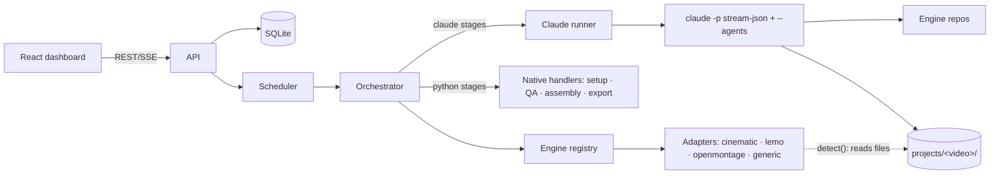

# SpaceStudio — Phase 2 Technical Specification

This is the binding contract for implementation. When code and this spec disagree, fix one of them; don't let them drift apart.

## 0. Decisions taken (owner delegated them)

| Question | Decision | Reason |
|---|---|---|
| Runtime | Linux / **WSL2 Ubuntu** primary; backend code stays OS-portable (`pathlib`, no POSIX-only calls) | Engines rely on `sh` scripts. One tested arrangement. |
| Concurrency defaults | `max_claude_sessions=2`, `max_render_jobs=1`, per-engine caps from `engine.yaml` | Renders are RAM-heavy; Claude sessions are token-heavy |
| Engine installs | SpaceStudio shows each repo's documented setup command; it runs **only after an explicit click-to-confirm**, and the run is audit-logged | No silent installs |
| Distribution | Personal/local use. No AGPL code is imported or copied (OpenMontage is run as a separate program; its JSON is read). lemo docs aren't bundled. | Licence guardrails |
| Collaboration | **Collaborative mode is the default.** One video's stages are assigned to whichever engine (or SpaceStudio itself) is best for that capability, joined by a neutral interchange format. A single-engine "native" mode is also available. | Owner requirement: the repos work together |
| Claude usage | One Claude Code session per *lane* (see §4), resumed across stages with `--resume`. Specialist **Claude subagents** are passed through `--agents`. Deterministic stages (setup, QA, assembly, export) run in Python with no tokens. | Keeps context and saves tokens |
| First engine end-to-end | cinematic-skill | Smallest, fully free, explicit gates |

## 1. Repository layout

```
backend/
  pyproject.toml
  spacestudio/
    config.py          Settings (env SPACESTUDIO_* + <data_dir>/settings.json)
    db.py              SQLModel engine/session, create_all, simple migrations
    models.py          Tables (CONTRACT, §3)
    schemas.py         API request/response models
    audit.py           audit(event, **details) → AuditLog row
    security.py        path guard, zero-cost env filter, secret redaction
    workspace.py       per-video directory layout (CONTRACT, §5)
    events.py          in-process pub/sub → SSE
    api/               FastAPI routers (§6)
    workflow/
      stages.py        statuses, transitions, stage catalog (CONTRACT, §4)
      planner.py       config + engines → stage DAG
      orchestrator.py  advance jobs, gates, retries, resume after restart
      scheduler.py     persistent queue, slots, resource admission
      native.py        stage handlers that run in Python (setup, qa, assemble, export)
    claude/
      runner.py        spawn/stream/cancel `claude -p` (§7)
      prompts.py       stage protocol and stage prompts
      agents.py        subagent definitions passed through --agents
    engines/
      base.py          EngineAdapter interface (CONTRACT)
      registry.py      loads engines/*/engine.yaml, picks the adapter class
      generic.py       manifest-driven adapter (future repos)
      cinematic.py / lemo.py / openmontage.py
      onboarding.py    "add a repository" Claude job → draft engine.yaml
    interchange/
      schema.py        neutral files shared between engines (CONTRACT, §5)
    assembly/          ffmpeg segment normalise + concat + mux
    qa/                checks (§9)
    main.py            app factory, static frontend serving, startup recovery
  tests/
engines/<id>/engine.yaml   engine manifests (data, not code)
frontend/                  Vite + React + TS + Tailwind
scripts/spacestudio-slot   render semaphore wrapper (file lock)
docs/
```

## 2. Architecture



## 3. Data model (SQLModel, SQLite → PostgreSQL-ready)

All IDs are short strings (`v_8hex`, `b_8hex`, …). Timestamps are UTC ISO strings. JSON columns use `sa_column=Column(JSON)`.

| Table | Key columns |
|---|---|
| `Project` | id, name, description, created_at |
| `Batch` | id, project_id, name, shared_config(JSON), status, created_at |
| `Video` | id, project_id, batch_id?, title, idea, config(JSON: VideoConfig), mode(`collaborative`\|`native`), primary_engine, status(JobStatus), workspace(path), created_at, updated_at, cost_usd, error |
| `Stage` | id, video_id, key (unique per video), name, description, owner (`spacestudio` \| engine id), lane, capability, depends_on(JSON list of keys), gate(bool), status(StageStatus), attempt, started_at, completed_at, progress(float?, only when real), last_activity, inputs(JSON), outputs(JSON), warnings(JSON), error, cost_usd, session_id, order |
| `StageVersion` | id, stage_id, version, created_at, files(JSON), snapshot_dir, note, approved(bool) |
| `Approval` | id, stage_id, decision(`approve`\|`request_changes`\|`reject`\|`skip`), feedback, created_at |
| `ClaudeSession` | id, video_id, lane, session_id, model, cwd, created_at, last_used_at, total_cost_usd |
| `Run` | id, stage_id, pid, started_at, ended_at, exit_code, cost_usd, log_path, kind(`claude`\|`native`), state(`running`\|`done`\|`failed`\|`cancelled`\|`interrupted`) |
| `Asset` | id, video_id, path, kind, stage_key, source, license, credit, created_at |
| `AuditLog` | id, at, actor, event, details(JSON) |
| `Engine` | id, name, enabled, path, pinned_commit, manifest(JSON), last_health(JSON), approved(bool) |
| `Setting` | key, value(JSON) |

## 4. Workflow state model

**StageStatus:** `pending → queued → running → (awaiting_approval | needs_input | completed | failed | cancelled)`. `skipped` is terminal.
Transitions:

- `awaiting_approval` + approve → `completed`
- `awaiting_approval` + request_changes → `queued` (attempt+1, feedback attached, previous outputs snapshotted as a StageVersion)
- `awaiting_approval` + reject → `failed`
- `needs_input` + answer → `queued`
- `failed` + retry → `queued`
- skip is allowed only when the stage is not `required`, from `pending`, `failed` or `awaiting_approval`
- Requesting changes also resets every **completed descendant** to `pending` (their outputs are snapshotted first).

**JobStatus (Video):** `draft, queued, running, paused, awaiting_approval, needs_input, completed, failed, cancelled, interrupted`. Derived from the stages, plus the explicit pause/cancel flags.

**Lanes.** A lane is one Claude Code session with its own cwd:

- `main`: cwd = video workspace; runs the SpaceStudio-owned creative stages.
- `engine:<id>`: cwd = `work/<engine-id>/` inside the video workspace (an OpenMontage lane sets `OPENMONTAGE_PROJECTS_DIR` to it). Stages in the same lane run serially and resume the same session; different lanes of one video can run in parallel when the DAG allows and slots are free.

**Stage catalog (collaborative mode):**

| key | owner (default) | capability | gate | depends_on |
|---|---|---|---|---|
| setup | spacestudio (python) | setup | – | – |
| research | spacestudio (claude, main) | research | – | setup |
| factcheck | spacestudio (claude) | factcheck | – | research |
| concept | spacestudio (claude) | concept | ✔ | factcheck |
| script | spacestudio (claude) | script | ✔ | concept |
| storyboard | spacestudio (claude) | storyboard | ✔ | script |
| asset_plan | spacestudio (claude) | asset_plan | ✔ | storyboard |
| assets | engine (archive images → cinematic `fetch_commons`, footage → openmontage) | asset_acquisition | – | asset_plan |
| narration | engine (voice: lemo Kokoro / openmontage Piper / cinematic say/espeak / user file) | narration | – | storyboard |
| segment:<n> | engine per segment (cinematic / lemo / openmontage) | scene_render | – | assets, narration |
| preview | spacestudio (python assembly, low-res) | preview | ✔ | all segments |
| sound | spacestudio (python mix) or engine | sound_design | – | preview |
| render | spacestudio (python assembly, full) | render | – | sound |
| captions | spacestudio (python srt + burn-in) | captions | – | render |
| qa | spacestudio (python) | qa | – | captions |
| export | spacestudio (python) | export | ✔ | qa |

In **native** mode the planner asks the engine adapter for its own stage list (`adapter.native_stages(config)`) and adds setup/qa/export around it.

The storyboard is where collaboration is decided. Claude writes `interchange/storyboard.json`, where every scene names `segment` and `engine` (chosen from the enabled engines' capabilities, or forced by the user). The planner then creates one `segment:<n>` stage per segment.

## 5. Workspace and interchange format

```
<data_dir>/projects/<video-id>/
  project.json                  Video snapshot (id, title, config)
  brief.json                    interchange.Brief
  research/   research.json (Research) · sources.md · factcheck.json (FactCheck)
  scripts/    script.json (Script) · v<n>/ previous versions
  storyboard/ storyboard.json (Storyboard)
  assets/     manifest.json (AssetManifest) · images/ footage/ music/ sfx/ user/
  narration/  narration.wav · timing.json (NarrationTiming) · lines/
  scenes/     <segment-id>.mp4 (segment renders, normalised)
  subtitles/  <lang>.srt
  renders/    preview.mp4 · final.mp4
  outputs/    <slug>.mp4 · <slug>.srt · poster.jpg · credits.md
  credits/    credits.md · per-engine CREDITS copies
  work/<engine-id>/  engine-native workspace (lane cwd)
  logs/       <stage>.<attempt>.jsonl (raw stream-json) · native.log
  .spacestudio/ events.jsonl (stage protocol) · versions/<stage>/<n>/ · tmp/
```

The neutral models (pydantic) live in `interchange/schema.py`. These are the only files one engine hands to another.

## 6. REST API (prefix `/api`)

| Method & path | Body / query | Returns |
|---|---|---|
| GET `/health` | – | `{ok, version}` |
| GET `/system/health` | – | `HealthReport` (tools + engines + credentials + zero_cost_ready) |
| GET/PUT `/settings` | `Settings` | `Settings` |
| GET `/engines` | – | `EngineInfo[]` (manifest summary, capabilities, health, enabled) |
| GET `/engines/{id}` · POST `/engines/{id}/health` · PATCH `/engines/{id}` `{enabled, path, pinned_commit}` | | `EngineInfo` |
| POST `/engines/{id}/setup` `{confirm: true, step}` | runs a documented setup step | `Run` |
| POST `/engines/onboard` `{url_or_path}` | starts an onboarding job | `{job_id}` |
| GET `/presets` | – | video-type presets, styles, options, each with the supporting engines |
| POST `/ideas/generate` `{topic, count, video_type}` | Claude generates ideas (small, synchronous with timeout) | `{ideas: [{title, idea}]}` |
| GET/POST `/projects` · GET/DELETE `/projects/{id}` | | Project |
| GET `/videos?project_id&batch_id&status` · POST `/videos` `VideoCreate` | | Video / Video[] |
| GET `/videos/{id}` | | `VideoDetail` (video + stages + sessions) |
| POST `/videos/{id}/start` · `/pause` · `/resume` · `/cancel` · `/retry` | | Video |
| PATCH `/videos/{id}/config` | partial VideoConfig (only while draft or between stages) | Video |
| GET `/videos/{id}/stages/{key}` | | `StageDetail` (stage + versions + approvals + runs + log tail) |
| POST `/videos/{id}/stages/{key}/approve` · `/request-changes` `{feedback}` · `/reject` `{feedback}` · `/retry` · `/skip` · `/answer` `{answer}` | | Stage |
| GET `/videos/{id}/stages/{key}/logs?tail=500` | | `{lines: [...]}` |
| GET `/videos/{id}/files?path=` | lists the workspace (path-guarded) | `FileEntry[]` |
| GET `/videos/{id}/file?path=` | serves the file (range requests for video) | bytes |
| PUT `/videos/{id}/file?path=` | text edit of editable files (script/storyboard JSON, md), creates a version | `FileEntry` |
| GET `/videos/{id}/assets` | | `Asset[]` |
| GET `/videos/{id}/history` | audit + versions for the video | `HistoryItem[]` |
| GET `/videos/{id}/export` | zip of the workspace minus `work/**/node_modules`, tmp | zip |
| POST `/batches` `BatchCreate {project_id, name, shared_config, items: [{title, idea, overrides}]}` · POST `/batches/import` (multipart CSV/TXT) → parsed items preview | | Batch |
| GET `/batches` · GET `/batches/{id}` (with videos and progress) · POST `/batches/{id}/start {video_ids?}` · `/pause` · `/resume` · `/cancel` · GET `/batches/{id}/export` | | Batch |
| GET `/queue` | running and queued runs with slot usage | `QueueState` |
| GET `/audit?limit=` | | AuditLog[] |
| GET `/events` (SSE) | `?video_id=` optional | events: `video.updated`, `stage.updated`, `log`, `queue.updated`, `health.updated` |

## 7. Claude Code runner

Command (flags verified against CLI 2.1.332):

```
<claude_bin> -p <prompt> --output-format stream-json --verbose
  [--resume <session_id>]                       # subsequent stages in a lane
  --permission-mode <settings.claude_permission_mode, default "acceptEdits">
  --allowedTools <engine.allowed_tools + defaults>
  --add-dir <engine repo path> ...
  [--plugin-dir <engine plugin dir>]            # engine.yaml invocation.plugin_dir
  --append-system-prompt <stage protocol>
  --agents <json: subagent defs>                # claude/agents.py
  [--model M] [--effort E] [--max-budget-usd X]
cwd = lane cwd; env = filtered env (security.child_env) + engine env + TMPDIR
```

- stdout lines are JSON events. Each one is written raw to `logs/<stage>.<attempt>.jsonl`. `system/init` gives `session_id` and `model`. `assistant` tool_use blocks give `last_activity`. `result` gives `total_cost_usd`, `is_error` and `permission_denials` when present.
- stderr is logged and redacted.
- Cancellation: SIGTERM to the process group, then SIGKILL after 10 s.
- Timeout: `stage_timeout_minutes` (default 90).
- After exit, the orchestrator never trusts the exit code alone. It calls `adapter.detect()` or the stage's `verify()` against files, and reads `.spacestudio/events.jsonl` for the `awaiting_approval` / `needs_input` / `stage_completed` / `error` events the protocol requires.
- If the CLI is missing, the stage fails with an actionable message.
- `settings.claude_bin` can point to `tests/fake_claude.py` for tests. **The UI shows a "SIMULATED" badge** whenever the configured binary isn't the real `claude`.

**Stage protocol** (appended system prompt, `claude/prompts.py`): workspace boundary; zero-cost rules; never ask interactive questions — append `{"type":"needs_input","stage":k,"question":...}` and end the turn; at a gate, append `awaiting_approval` with a summary and end the turn; on finishing, append `stage_completed` with the output paths; wrap heavy renders in `spacestudio-slot render -- <cmd>`; write interchange files exactly to the schema.

**Subagents** (`--agents`): `researcher`, `fact-checker`, `scriptwriter`, `storyboard-artist`, `asset-librarian`, `voice-director`, `qa-reviewer`. Each has a focused prompt. Stage prompts tell the main session which subagents to delegate to (e.g. research spawns researcher and fact-checker in parallel).

## 8. Scheduler

- An asyncio loop every 1 s (or on events). Candidates are stages in `queued` whose dependencies are `completed`/`skipped`, whose video isn't paused/cancelled, and whose lane is idle.
- Admission:
  - claude stage → `claude_slots` < max
  - render-capable stage (capability in {scene_render, render} or engine `render_heavy_stages`) → also `render_slots` < max
  - free RAM ≥ `min_free_ram_gb` (psutil, if available)
  - engine cap
- Ordered FIFO by `video.created_at`, then `stage.order`.
- **Startup recovery:** any Run in `running` whose pid is dead → `interrupted`, and its stage → `queued` with `resume=True` (the prompt says to verify existing outputs before redoing work). `awaiting_approval` / `needs_input` survive as-is.
- `spacestudio-slot`: `fcntl` file-lock semaphore under `<data_dir>/slots/render.N.lock`. Native render passes and Claude-run renders share it. Lemo gets `RENDER_SLOTS`; cinematic gets `--workers` from `settings.render_workers`.

## 9. QA checks (`qa/`)

Each check returns `{id, name, status: passed|warning|failed|not_run, detail}`. `not_run` is used when the tool needed (e.g. ffprobe) is missing; a check is never reported as passed without running.

- output exists and isn't empty; ffprobe parses it
- width/height match the config; aspect ratio; fps
- duration within ±10% of the target (warning) / ±35% (failed)
- has an audio stream; loudness (ffmpeg `ebur128`): integrated LUFS and true peak; clipping when TP > −0.5 dBTP
- black-frame ratio (`blackdetect`)
- captions file present when captions are enabled; SRT parses; last cue ≤ duration
- credits present when the asset manifest has third-party items; every asset has a licence
- unresolved fact-check warnings (`factcheck.json` items with status ≠ verified)
- incomplete stages
- broken paths in `assets/manifest.json`

## 10. Zero-cost enforcement

`security.child_env(zero_cost, allow_free_keys)`:

- starts from a minimal allowlist (PATH, HOME, LANG, TERM, TMPDIR, USER, SHELL, plus the Claude auth variables)
- adds the engine's declared non-secret env
- in zero-cost mode, drops every name in any engine's `cost.paid_env`
- outside zero-cost, passes paid keys only for providers the user approved for that video (`config.approved_paid_providers`)

The OpenMontage adapter's health check fails `zero_cost_ready` if `<repo>/.env` has non-empty paid keys. After each OpenMontage stage, any `cost_snapshot` with spend > 0 under zero-cost **fails the stage** with a "paid provider used" error. Logs and API responses pass through `security.redact()`, which masks the values of known secret env vars and patterns like `sk-…` and `key=…`.

## 11. Milestones (reordered for the owner's delegation)

- P3: skeleton, health, engines registry, runner with fake-claude tests
- P4: collaborative flow + the three adapters
- P5: visibility/approvals
- P6: batch/scheduler
- P7: QA, tests, docs

Built in parallel by subagents against these contracts.
